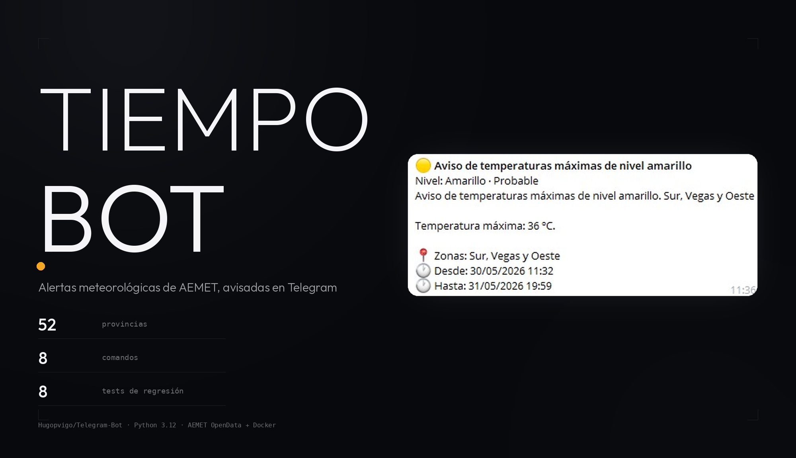
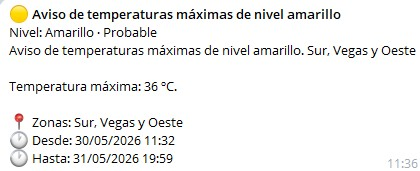
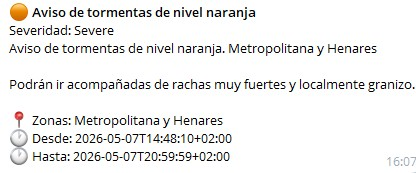

<meta property="og:title" content="TELEGRAM-BOT">
<meta property="og:description" content="Un bot de Telegram que avisa de los avisos meteorológicos de AEMET.">
<meta property="og:image" content="https://raw.githubusercontent.com/Hugopvigo/Telegram-Bot/main/docs/capturas/og.png">

<p align="center">
  
</p>

<p align="center">
  <b>Un bot de Telegram que avisa de los avisos meteorológicos de AEMET.</b><br>
  Te suscribes a tu provincia y te avisa en cuanto hay nivel amarillo o más.
</p>

<p align="center">
  
  
  
  
  <a href="https://tiempo.hugoperezvigo.es/"></a>
</p>

---

## Qué es esto

TiempoBot comprueba la API **OpenData de AEMET** y avisa en Telegram de los
avisos meteorológicos de la provincia a la que te has suscrito:

- **52 provincias**, con Ceuta y Melilla incluidas, y un teclado para elegir
  la tuya sin escribir nada.
- **Solo avisa de lo que importa**: desde nivel **amarillo** para arriba. Los
  avisos verdes (severidad *minor*) se ignoran.
- **No repite**: cada aviso se manda una sola vez, con una clave de
  deduplicación estable entre elaboraciones de AEMET.
- **Limpia solo**: los avisos ya enviados se borran de la base a los 7 días.
- **Avisos nacionales** aparte, con `/alertas_nacionales`.

Python 3.12, `python-telegram-bot` y `httpx`, con SQLite para recordar las
suscripciones. Docker incluido.

## Los avisos

| | |
|---|---|
|  |  |
| Aviso amarillo por temperaturas máximas. | Aviso naranja por tormentas. |

Cada aviso llega con su nivel (verde, amarillo, naranja o rojo), su
probabilidad, el texto del fenómeno, las zonas afectadas y el intervalo de
validez.


## Comandos

| Comando | Qué hace |
|---|---|
| `/start` | Mensaje de bienvenida; con provincia (`/start Madrid`) te suscribe |
| `/suscribir` | Suscribe a una provincia; sin argumento, abre el teclado |
| `/provincias` | Lista las 52 provincias |
| `/alertas` | Consulta los avisos activos de tu provincia |
| `/alertas_nacionales` | Avisos de todo el país |
| `/clima` | Enlaza con la web y la app del tiempo |
| `/estado` | Estado de tu suscripción |
| `/cancelar` | Cancela la suscripción |

## De dónde salen los avisos

De la API OpenData de [AEMET](https://opendata.aemet.es/), en formato CAP
1.2: se descarga el últimoaborado de la comunidad autónoma de la provincia y
se parsean los avisos XML del `tar.gz`.

AEMET emite un aviso por zona y por día de validez, así que un mismo
fenómeno llega partido en varios avisos que solo se diferencian en la fecha
de fin. El bot **los colapsa en uno solo**, con el rango de validez completo
(del `effective` más temprano al `expires` más tardío), y calcula una clave
de deduplicación que no depende del identificador crudo de AEMET (cambia en
cada elaboración).

El filtrado por severidad usa la escala de CAP: `Minor` (verde),
`Moderate` (amarillo), `Severe` (naranja) y `Extreme` (rojo). El umbral de
notificación es `Moderate`.

## Instalación

### Local

```bash
python -m venv .venv
source .venv/bin/activate        # Windows: .venv\Scripts\activate
pip install -r requirements.txt

cp .env.example .env             # y rellena las dos claves
python run.py
```

### Docker

```bash
cp .env.example .env             # y rellena las dos claves
docker compose up -d

docker compose logs -f           # ver el log
docker compose down              # parar
```

El bot guarda la base de datos en `./data` (volumen montado en `/data`).

### Variables de entorno

| Variable | Para qué | Por defecto |
|---|---|---|
| `TELEGRAM_BOT_TOKEN` | Token del bot de [@BotFather](https://t.me/BotFather) | *obligatoria* |
| `AEMET_API_KEY` | Clave de [AEMET OpenData](https://opendata.aemet.es/) | *obligatoria* |
| `CHECK_INTERVAL_MINUTES` | Minutos entre consultas a AEMET | `10` (`20` en `.env.example`) |
| `DB_PATH` | Ruta de la base de datos SQLite | `/data/users.db` |

Al arrancar, el bot espera a que resuelva DNS antes de hacer nada: está
pensado para máquinas donde la red de Docker todavía no está lista.

## Tests

8 tests de regresión, sin red: la fusión de avisos de AEMET (con un caso
real de la elaboración de las 09:33 del 17/06/2026) y el tratamiento de los
errores transitorios de Telegram.

```bash
docker cp tests tiempobot:/tmp/tbtests
docker exec tiempobot python -m unittest discover -s /tmp/tbtests -t /app -v
```

## Repositorio

```
Telegram-Bot/
├── app/
│   ├── main.py       arranque, espera de red y comprobación periódica
│   ├── bot.py        comandos, teclado de provincias y registro
│   ├── aemet.py      cliente de AEMET, parseo CAP y fusión de avisos
│   ├── database.py   SQLite: suscriptores y avisos ya enviados
│   ├── scheduler.py  comprobación periódica y envío
│   ├── rich.py       mensajes enriquecidos de Telegram
│   ├── config.py     variables de entorno
│   └── stream.py     utilidades de mensajes provisionales (sin uso)
├── tests/            tests de regresión
├── assets/           icono y capturas de los avisos
├── docs/capturas/    cabecera e imágenes del README
├── run.py
├── Dockerfile
└── docker-compose.yml
```

## Licencia

El código de este repositorio está bajo **CC BY-NC-SA 4.0** (atribución, no
comercial y obras derivadas bajo la misma licencia). Véase
[LICENSE](LICENSE).
